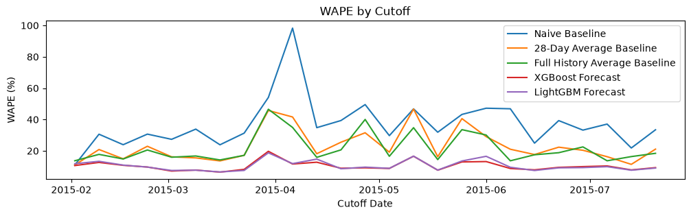
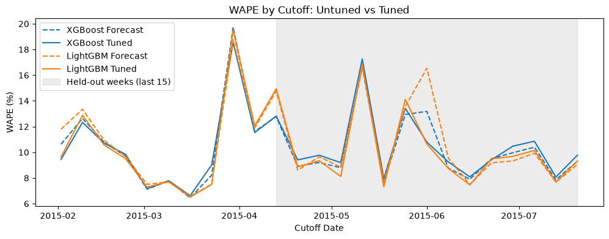

# sales-forecasting-project

Forecasting daily sales for the Rossmann stores, 7 days ahead, to test whether deep learning earns its complexity over gradient boosting. simple baselines are the floor, then xgboost and lightgbm, then deep learning models with the same features and the same test.

status: baselines, features, xgboost, lightgbm and tuning are done. deep learning, a pretrained forecasting model and a dashboard are next.

## Why this matters

Retailers need to predict how much they'll sell in the coming days and weeks to make real decisions: how much stock to order, how many staff to schedule, and when to run promotions. Getting this wrong means either running out of stock (lost sales) or over-ordering (wasted inventory). This project builds and compares several forecasting approaches to predict daily sales at the store level.

## Dataset

This project uses the [Rossmann Store Sales dataset](https://www.kaggle.com/datasets/pratyushakar/rossmann-store-sales) from Kaggle, containing:

- ~1,017,000 daily sales records
- 1,115 stores
- Data from January 2013 to July 2015
- Includes store-level info (store type, competition distance) and daily context (promotions, holidays)

To run this project yourself, download the dataset from Kaggle and place the CSVs in a `data/` folder.

## Key findings (exploratory analysis)

- **Weekly seasonality**: Sales are highest on Mondays and dip toward the middle of the week. Most stores are closed on Sundays; the small number that stay open show unusually high sales, likely due to differences in store type or location.
- **Holiday effect**: Sales spike sharply in the days leading up to Christmas (peak seen Dec 23), consistent with last-minute holiday shopping before stores close.
- **Promotion effect**: All three of the top non-holiday sales days in the dataset coincided with company-wide promotional events — each had 100% of stores running a promotion, compared to a ~38% baseline on a typical day. This suggests promotions may be one of the strongest predictors of sales in this dataset, potentially rivaling the holiday effect.

## The Question

does deep learning beat gradient boosting on retail demand forecasting, and is it worth the extra complexity? the boosted trees are tested first, with simple baselines as the floor. the deep learning models get the same features, the same test and the same tuning budget, so the comparison is fair.

## How It Is Tested

- rolling backtest: 25 weekly forecasts, 7 days ahead, every monday from 2015-02-02 to 2015-07-20, for all 1,115 stores (195,125 forecast rows)
- the model is refitted at every cutoff using only the data before it
- features: day of week, promo, school and state holidays, calendar features, store type, assortment, competition distance and months, promo2, sales lags (7, 14 and 28 days) and 4 and 8 week same weekday averages
- every feature only looks back from its own row, and a leakage test checks this. customers and open are left out because they are only known after the day
- score: WAPE, pooled over all rows so big stores count for more. RMSE and MAE are also reported
- tuning: a random search of 25 tries per model (plus the default), using the first 10 cutoffs only. the last 15 cutoffs are never seen by the search

## Results

| Model | WAPE, last 15 weeks | WAPE, all 25 weeks |
|---|---|---|
| LightGBM (tuned) | 10.01% | 10.18% |
| XGBoost | 10.14% | 10.33% |
| XGBoost (tuned) | 10.25% | 10.31% |
| LightGBM | 10.49% | 10.57% |
| Full history average baseline | 21.62% | 21.53% |
| 28 day average baseline | 23.14% | 22.63% |
| Naive baseline (last week) | 36.70% | 36.06% |

the last 15 weeks are the fairer test of tuning, because the search never saw them.



the baselines spike around easter (the 30 mar and 6 apr cutoffs), because they predict a normal day on a holiday. the models have the holiday flag, so they spike much less.



the shaded weeks are the 15 the search never saw. the tuned and untuned lines mostly overlap there, apart from the week of 1 june.

## What I Found

- the boosted models have about half the error of the best baseline (10.0% to 10.5% against 21.6%)
- state holidays matter a lot. 97% of store days on a state holiday have zero sales (against 0.2% on other non sunday days). the baselines predict a normal day, so they spike badly around easter. the models have the holiday flag, so their spikes are much smaller
- for xgboost, the sales history features carry about 65% of the importance, then the state holiday flag, then promo
- tuning did not reliably help. tuned xgboost is slightly worse than the default on the held out weeks, and nearly all of lightgbm's gain comes from one week (1 june). the defaults were already close to as good as the search could find
- a lightgbm try cost about a third of an xgboost one (about 45 seconds against about 130), for similar error

caveat: the baselines only use past sales, while the models also see promo and holiday flags, so the gap to the baselines is not purely down to the algorithm.

caveat: every forecast is 7 days ahead from a monday, so this says nothing about longer horizons.

## Repo Structure

```
notebooks/   01 exploration, 02 baselines, 03 features, 04 xgboost, 05 lightgbm, 06 tuning
src/         the code the notebooks use (backtest, baselines, features, models, tuning, evaluation)
results/     scores for each model and the tuning tables
```

## How To Run

1. download the dataset from kaggle and put the CSVs in a `data/` folder
2. make a virtual environment and run `pip install -r requirements.txt` (python 3.12.10)
3. run the notebooks in order, 01 to 06

the backtest files are large, so they are not in the repo. notebooks 04, 05 and 06 have a `FORECAST` flag, so set it to `True` the first time to create them. each takes a few minutes. the saved tuning tables are in the repo, so the searches do not need to be rerun (they take about 53 and 20 minutes).

## What's Next

- deep learning: a feed forward network, then a sequence model, using the same features, backtest and tuning budget, and comparing cost as well as error
- a pretrained forecasting model, tested without any training on this data
- a dashboard for the best model
- a final write up